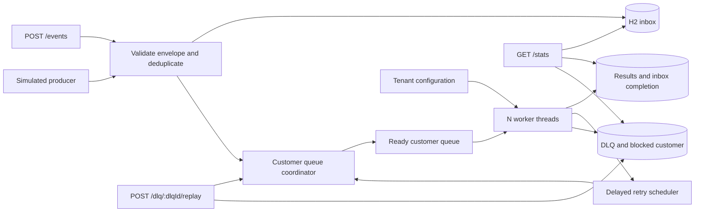

# Engagement Event Processing — Design Draft

**Status:** Implemented baseline; design remains open for refinement.  
**Updated:** 17 October 2026

## Exercise constraints

- Implement the working version with Java's own concurrency toolkit: `BlockingQueue`, `ExecutorService`, locks, scheduled executors, and/or virtual threads. Do not embed or run Kafka for the exercise.
- The README must map these in-memory concepts to a real Kafka deployment and call out where the semantics differ.

## 1. Goal and design decisions

Build a service that accepts engagement events, processes different customers in parallel, and processes each customer's events in acceptance order. Processing includes validation, tenant enrichment, and storing a result.

| Concern | Initial decision |
| --- | --- |
| Implementation | A modern modular monolith in Java/Spring Boot with a fixed pool of `N` workers and H2 in file mode. Liquibase owns all schema migrations. |
| Deployment | One Spring Boot application in one container owns scheduling and processing. Chat, email, and voice are internal modules, not separate deployable services. Multi-instance coordination is outside this draft. |
| Ordering key | `customerId`, across CHAT, EMAIL, and VOICE, matching the problem statement literally. |
| Order definition | Durable acceptance order, represented by a monotonically increasing sequence per customer. Client timestamps do not determine processing order. |
| Idempotency key | Globally unique `eventId`. Reusing an ID with different event contents is a conflict. |
| Delivery | Accepted events are attempted until successfully committed or placed in the DLQ. An interrupted attempt can be delivered again. |
| Retry budget | Three failed attempts per processing cycle: the initial attempt and two retries. |
| DLQ behavior | A dead-lettered event blocks its customer queue until replay succeeds. Other customers continue. |
| Persistence | H2 stores the inbox, results, retry state, customer sequences, and DLQ history. In-memory storage is an optional simplified variant with no restart durability. |
| User preferences | Tenant-scoped subscription rows decide whether a user/customer wants a notification type on a channel. A disabled preference suppresses outbound delivery but does not discard the accepted engagement event. |
| Preference propagation | Observer pattern inside the monolith: preference updates publish a `PreferenceChangedEvent`; cache, routing, and change-log observers react independently. The database remains authoritative. |
| Identifier type | Tenant, customer, event, preference, change-log, and DLQ identifiers use `UUID` throughout the API and Java code. H2 stores their canonical 36-character representation in `VARCHAR` columns. |

Blocking a customer after dead-lettering is intentional. Advancing later events and subsequently replaying the earlier event would break strict ordering. This trades availability for that customer for the requested ordering guarantee.

## 2. Event contract

```json
{
  "eventId": "33333333-3333-4333-8333-333333333333",
  "tenantId": "11111111-1111-4111-8111-111111111111",
  "customerId": "22222222-2222-4222-8222-222222222222",
  "channel": "CHAT",
  "payload": {
    "message": "I need help with my order"
  },
  "timestamp": "2026-10-07T14:00:00Z"
}
```

| Field | Contract |
| --- | --- |
| `eventId` | Required UUID; immutable identity used for deduplication. |
| `tenantId` | Required UUID; used to retrieve tenant configuration. |
| `customerId` | Required UUID; determines the processing queue. |
| `channel` | Required enum: `CHAT`, `EMAIL`, or `VOICE`. |
| `payload` | Required JSON object; channel-specific validation happens during processing. |
| `timestamp` | Required ISO-8601 timestamp with an offset, normalized to UTC; represents event occurrence time. |

The service adds `receivedAt`, `customerSequence`, processing status, attempt counts, and timestamps. A successful result includes the original event, enrichment data, `tenantConfigVersion`, and `processedAt`.

The immutable fields above define duplicate equivalence. JSON object property order and equivalent timestamp offsets do not make otherwise identical submissions different. Compare normalized contents when checking a duplicate; use a stored fingerprint as an optimization, not as the sole correctness check.

## 3. Components and data flow

The application is a modular monolith: one deployable unit and process, with explicit internal module boundaries. Suggested packages are `common`, `event`, `processing`, `preference`, `notification.handler`, `dlq`, `tenant`, and `stats`. `ChatNotificationHandler`, `EmailNotificationHandler`, and `VoiceNotificationHandler` implement the shared `NotificationHandler` interface. `NotificationHandlerFactory` selects the implementation for an event channel, so processing depends only on the abstraction. Handlers do not own separate queues or consumer processes.



| Component | Responsibility |
| --- | --- |
| Event controller | Accept events, reject invalid envelopes, return acceptance or duplicate status. |
| Optional load generator | Submit generated events through the same admission path; configure volume, customer distribution, channels, and submission concurrency. |
| Admission service | Enforce backlog capacity, deduplicate, assign a customer sequence, and persist before acknowledgment. |
| Customer queue coordinator | Maintain one logical FIFO queue per customer and decide which queue head can run. |
| Ready queue | Hold eligible customer tokens; workers draw from a shared queue. |
| Worker pool | Validate the payload, retrieve tenant configuration, enrich, and commit a result or failure transition. |
| Preference service | Read tenant-scoped user subscriptions and decide whether an outbound notification is enabled. |
| Retry scheduler | Wake a customer when its head becomes eligible again; waiting consumes no worker thread. |
| Repositories | Store inbox state, successful results, failure information, customer sequences, and DLQ history. |
| DLQ service | Inspect dead letters and replay an original queue head. |
| Statistics service | Report committed results, active attempts, retry starts, DLQ transitions, and channel throughput. |
| Preference observers | Update an optional cache, refresh notification routing, and record a JSON change log after preference changes. |

## 4. Customer ordering — the central mechanism

Use **logical queues per customer**, dispatched onto the shared worker pool. Do not assign a permanent worker thread to each customer. This lets many customers share `N` threads without imposing ordering between unrelated customers.

### Invariants

1. A customer has at most one active processing attempt.
2. Only that customer's lowest unresolved sequence can start an attempt.
3. Retries keep the same event at the head with its original sequence.
4. The next event becomes eligible only after the head's successful result and completion status commit.
5. A DLQ head remains unresolved and blocks its successors.
6. Duplicate submissions allocate neither a new sequence nor another queue entry.

### Admission

1. Validate the routing envelope. Reject malformed requests before acceptance.
2. If `eventId` already exists, compare normalized contents and return the existing status, or reject conflicting contents.
3. Reserve an unresolved-backlog capacity permit atomically.
4. Serialize new acceptance for this customer with its coordinator lock. In one database transaction, allocate the next customer sequence and insert a `QUEUED` inbox row.
5. Commit before returning `202 Accepted`. A database unique constraint handles concurrent duplicate submissions; return the winning row's status after checking equivalence and release the unused capacity permit.
6. If this is an eligible head and the customer is not already scheduled or running, publish one ready token.

Concurrent requests for the same customer are ordered by successful durable acceptance, not by request start time. The customer lock covers sequence allocation through commit. The database remains the source of truth; if a process dies between commit and scheduling, restart recovery schedules the accepted event.

### Dispatch and completion

- A ready token identifies a customer and a generation. Under the customer lock, a worker verifies the token, eligibility, and current head, then atomically persists `RUNNING` and increments `attemptStarts`. It begins processing only after the claim is confirmed.
- The worker releases the customer lock before validation, enrichment, or other lengthy work. The customer remains claimed while the attempt runs.
- On success, it commits the result and `PROCESSED` status in one transaction. It then advances the queue, releases the backlog permit, and places the next eligible customer token at the tail of the ready queue.
- On failure, it commits either `RETRY_WAIT` with a due time or `DLQ` with a dead-letter record. The head stays in place.
- Queue state transitions and token generation checks use the same customer lock. Duplicate or stale tokens and timer callbacks cannot start overlapping attempts.

Process one event per dispatch before requeuing the customer. This gives other ready customers an opportunity to run even when one customer has a large backlog.

For the initial implementation, retain customer coordinator objects for the process lifetime. Removing them without coordinating existing references could create two locks for the same customer. Safe eviction can be added later if customer cardinality requires it.

### Example with two workers

```text
Accepted customer A: A1, A2, A3
Accepted customer B: B1, B2

Worker 1: A1 fails -> A waits for retry -> A1 succeeds -> A2 -> A3
Worker 2: B1 succeeds -> B2 succeeds

During A's retry delay, either available worker can process other customers.
A2 never starts while A1 is running, waiting for retry, or in the DLQ.
```

This guarantee covers processing attempts and committed results inside this service. Client-generated timestamps or upstream events that have not yet arrived cannot establish an earlier position in an already accepted queue.

## 4.1 User preferences and Observer pattern

Treat `user` as the end customer who receives a notification. A preference is scoped by tenant, user/customer, notification type, and channel. For example, a user may allow `ORDER_STATUS` by EMAIL but disable `PROMOTION` by CHAT for one tenant. A missing row uses the tenant default policy.

The preference check applies to outbound notification delivery after the engagement event has been validated and enriched. The original event and its processing result remain auditable even when delivery is suppressed. Suppression is a business outcome (`SUPPRESSED_BY_PREFERENCE`), not a transient failure, so it is not retried or sent to the DLQ.

Use the Observer pattern for preference changes:

```text
UserPreferenceService (Subject)
        |
        +--> PreferenceCacheObserver
        +--> NotificationRoutingObserver
        +--> PreferenceChangeLogObserver
```

The update flow is:

1. Validate tenant, user/customer, notification type, channel, and `enabled` value.
2. Upsert the preference row and increment its version in one transaction.
3. After commit, publish `PreferenceChangedEvent` through the in-process application event publisher.
4. Observers react independently. A cache observer refreshes or invalidates cached policy; a routing observer updates notification decisions; a change-log observer records who changed the preference and stores `{"prevValue": ..., "currValue": ...}` in a `VARCHAR`. The API DTO parses it into a JSON object.
5. If an observer fails, retry or rebuild that observer's derived state from the database. Do not roll back the committed preference because a cache or change-log observer is unavailable.

The preference database is authoritative. A notification decision must use the preference version loaded with the event, and a stale cache must fail closed for an opted-out preference or fall back to a database read. Preference observers must not bypass the customer-lane ordering coordinator.

## 5. State and persistence model

```text
QUEUED -> RUNNING -> PROCESSED
                  -> RETRY_WAIT -> RUNNING
                  -> DLQ -> QUEUED (explicit replay)
```

`RUNNING -> RETRY_WAIT` follows the first or second failed attempt. The third failure produces `RUNNING -> DLQ`. Waiting successors remain `QUEUED`.

| Store | Important fields and constraints |
| --- | --- |
| `tenant_account` | `tenantId` primary key and lifecycle timestamps; parent row for tenant-owned data. |
| `tenant_config` | One row per `(tenantId, channelType)` with `isEnabled`, `configVersion`, and timestamps. Adding a channel does not add a database column. |
| `customer_sequence` | `customerId` primary key, next sequence value. |
| `event_inbox` | `eventId` primary key, immutable event contents, content fingerprint, `customerSequence`, status, `attemptStarts`, `cycleFailures`, `nextAttemptAt`, latest error, failure history, timestamps. Unique `(customerId, customerSequence)`. |
| `processed_event` | `eventId` primary key, original event, enriched result, tenant configuration version, channel, customer sequence, `processedAt`. |
| `dead_letter` | Unique `dlqId` per DLQ transition, `eventId`, original customer sequence, failure summary/history, state (`ACTIVE` or `REPLAYED`), creation/replay timestamps. At most one active dead letter per event. |
| `user_preference` | `tenantId`, `userId`/`customerId`, `notificationType`, `channel`, `enabled`, `version`, `updatedBy`, `updatedAt`. Unique `(tenantId, userId, notificationType, channel)`. |
| `preference_change_log` | Change-log ID, tenant/user, serialized JSON `change_log` in `VARCHAR`, version, actor, and timestamp. The JSON contains `prevValue` and `currValue`. |

Keep indexes for unresolved customer heads, retry due times, active dead letters, and successful completions by channel/time.

`preference_change_log` is optional for the minimum exercise but recommended when preference changes need traceability. A cache is not a source-of-truth table and can remain in memory.

H2 should use a file-backed database with durable commits. Accepted events survive service restarts under the database's durability guarantees. An in-memory replacement can use the same repository interfaces, but loses queued events, results, deduplication history, and DLQ state on restart.

### Database migrations

Liquibase is the only mechanism for creating or changing the database schema. The changesets that create tables, constraints, and indexes will use Liquibase formatted SQL. Hibernate `ddl-auto`, ad-hoc startup SQL, and manually edited production tables are disabled. Keep a small master changelog that includes ordered SQL changesets:

```text
src/main/resources/db/changelog/
├── db.changelog-master.yaml
└── changes/
    ├── 001-create-tenant-config.sql
    ├── 002-create-customer-sequence.sql
    ├── 003-create-event-inbox.sql
    ├── 004-create-processed-event.sql
    ├── 005-create-dead-letter.sql
    ├── 006-create-user-preference.sql
    ├── 007-create-preference-audit.sql
    ├── 008-add-operational-indexes.sql
    ├── 009-normalize-tenant-channel-config.sql
    └── 010-rename-preference-change-log.sql
```

Each SQL file starts with `--liquibase formatted sql` and declares a stable `--changeset author:id`. Include rollback statements where practical. Application startup runs Liquibase before event ingestion begins. Tests use the same SQL changesets against an isolated H2 database.

## 6. Reliability and idempotency

### Atomic successful processing

Validation and enrichment produce a candidate result. Persisting it is the processing side effect in this exercise.

In one transaction:

1. Insert the result under the unique `eventId`, or verify an already committed result against the immutable event identity and contents. Preserve that result's original successful enrichment.
2. Mark the inbox event `PROCESSED`.
3. Commit.

After a confirmed rollback, neither operation is committed. A commit exception can have an uncertain outcome and requires reconciliation before retrying. If processing executes again, the database constraint prevents a second result record. A preliminary application check alone is insufficient under concurrency.

The event channel selects one tenant configuration row during enrichment; the successful result records that row's configuration version. A missing explicit user preference falls back to the selected channel's `isEnabled` value. The unused `configJson` placeholder was removed; future structured settings should receive typed fields or a separately designed metadata model when a concrete requirement exists. Enrichment is read-only here. If a later design adds external writes, those effects also need idempotency or an outbox protocol.

### Persistence failures and missed scheduling

For admission, claims, result commits, failure/DLQ transitions, and replay, distinguish a confirmed rollback from an unknown commit outcome. When the outcome is unknown, reread authoritative database state before releasing a capacity permit, advancing a customer, recording another failure, or scheduling another attempt. A client that receives an unavailable/uncertain acceptance response retries with the same `eventId`.

Keep an uncertain customer's coordinator reserved in an internal recovery state. Release its worker after the attempt has stopped, but do not allow that head or a successor to execute until reconciliation establishes the committed state. If the database is unavailable, reschedule reconciliation with backoff. Do not treat database unavailability as a successfully recorded event failure or repeatedly consume the event's failure budget. After a confirmed processing rollback, record its failure transition when the database is available.

A lightweight periodic reconciliation sweep checks persisted eligible heads and due retries against coordinator state, under the same customer locks. It repairs gaps between commit and publishing a ready token or timer without requiring a process restart. It respects active workers and never reclaims work merely because execution is slow. `inFlight` counts active worker attempts; temporarily stranded persisted `RUNNING` claims are reported separately as `recoveryPending` until reconciled.

### Retry policy

- Persist failure count, error details, and `nextAttemptAt` before arranging the retry.
- Initial backoff: `250 ms`; exponential multiplier: `2`; maximum: `5 seconds`.
- Add random positive jitter of up to 20% before applying the maximum delay.
- With this three-failure budget, waits are approximately `250 ms` after failure 1 and `500 ms` after failure 2. Failure 3 goes directly to the DLQ.
- Use a timer or delay queue to reschedule the customer; do not sleep a worker during backoff.
- A failed accepted event, including one rejected by consumer payload validation, uses the same budget in this draft. Malformed envelopes are rejected at admission and never enter this lifecycle.

For the simulation, select approximately 10% of event IDs with a seeded deterministic rule and fail their first lifetime attempt. Their next attempt can succeed. Use a separate configurable persistent-failure scenario to exercise the DLQ; first-attempt-only failures cannot reach it.

### Restart recovery

Before reopening event admission:

1. Load unresolved events ordered by customer sequence and rebuild each customer's head.
2. Reset interrupted `RUNNING` claims to eligible queued work unless a committed result already establishes completion.
3. Restore retry timers from persisted due times; overdue retries are eligible immediately.
4. Restore DLQ heads as blocked and leave their successors queued.
5. Restore backlog capacity permits from the unresolved count.

An interrupted attempt has an unknown outcome and does not consume a *failed-attempt* slot unless a failure transition was committed. Recovery may start additional attempts, so lifetime attempt starts can exceed three even though a processing cycle allows only three recorded failures.

Graceful shutdown stops admission and new dispatch, allows active attempts a bounded time to finish, and leaves remaining work persisted for recovery. Exactly one service instance may perform startup recovery and own processing.

## 7. Dead-letter inspection and replay

On the third failure, atomically mark the inbox head `DLQ` and create an `ACTIVE` dead-letter entry. Store enough original event and error information to inspect and replay it. Keep its customer sequence and backlog permit.

Replay operates on a specific `dlqId`, which identifies that failure cycle:

1. Under the customer lock, confirm that this entry is active and its event is still the customer's blocked head.
2. In one transaction, mark the entry `REPLAYED`, reset `cycleFailures` to zero, clear the retry due time, and return the same inbox event to `QUEUED`.
3. Preserve `eventId`, event contents, customer sequence, lifetime attempt count, and historical errors.
4. Advance the coordinator generation and schedule that original head. It gets a fresh three-failure budget; its successors wait for successful completion.

Repeated or concurrent replay requests for the same entry return the original replay outcome without resetting an already running retry cycle. If the event dead-letters again, create a new `dlqId`; a delayed request for the old entry cannot replay the new cycle.

Resubmitting the event to `POST /events` is deduplication, not replay. No skip/discard operation is included in this draft; abandoning a blocked head would require an explicit change to the ordering contract.

## 8. REST API

| Endpoint | Behavior |
| --- | --- |
| `POST /events` | Validate and durably accept one event. `202` for new acceptance; `200` for an identical existing event with its current status; `400` for an invalid envelope; `409` for conflicting ID reuse; `429` with `Retry-After` when the backlog is full; `503` when durable acceptance is unavailable. |
| `GET /dlq?limit=50&cursor=...` | Paginated active dead letters, including event data, customer sequence, attempt/failure counts, latest error, and dead-letter timestamp. A history filter can include replayed entries. |
| `POST /dlq/{dlqId}/replay` | `202` when replay is scheduled; `200` for an already replayed entry; `404` for an unknown entry; `409` for an inconsistent head/state. |
| `PUT /tenants/{tenantId}/users/{userId}/preferences` | Upsert a versioned subscription preference for a notification type and channel, then publish a preference-change event after commit. |
| `GET /tenants/{tenantId}/users/{userId}/preferences` | List effective and explicitly configured notification preferences for the user. |
| `GET /stats` | Snapshot of processing and throughput metrics. |

Example event acceptance:

```json
{
  "eventId": "33333333-3333-4333-8333-333333333333",
  "status": "QUEUED",
  "customerSequence": 6,
  "duplicate": false
}
```

The optional load generator should call the same admission service so ordering, deduplication, and overload rules remain identical to REST ingestion.

## 9. Statistics definitions

| Metric | Definition |
| --- | --- |
| `processed` | Number of distinct successfully committed event results. Duplicates and re-executions do not increase it. |
| `inFlight` | Active worker attempts, at most `N`; excludes queued events, backoff waits, DLQ heads, and stopped attempts awaiting persistence reconciliation. |
| `retried` | Lifetime extra attempt starts beyond each event's first attempt, including replay and recovery starts. Derived from `sum(max(attemptStarts - 1, 0))`. |
| `deadLettered` | Cumulative committed DLQ transitions; one event can contribute again after replay. |
| `dlqSize` | Number of currently active dead-letter entries. |
| `queued` | Number of `QUEUED` events, including successors of retrying or blocked heads. |
| `retryWaiting` | Number of heads currently waiting for a retry due time. |
| `blockedCustomers` | Number of customers with an active DLQ head. |
| `recoveryPending` | Customers whose stopped attempt or uncertain state is awaiting persistence reconciliation. |
| `perChannel` | Distinct processed total and successful completion rate for each of CHAT, EMAIL, and VOICE. |

Throughput uses a rolling 60-second window: successful completions in that window divided by 60. Include `windowSeconds` and `snapshotAt` in the response. Use server `processedAt`, not the event's occurrence timestamp. At startup, the denominator remains 60 for consistent window semantics.

Derive durable counters from committed inbox/results/DLQ data using a consistent database snapshot; sample `inFlight` and `recoveryPending` from coordinator state at approximately the same time. These operational gauges can move during collection. For this exercise, database queries are sufficient; cached counters can be added if measurements justify them. Persist attempt starts when a worker claims an event so retry metrics survive restart.

## 10. Capacity and operational bounds

Configure worker count `N`, maximum unresolved events, request payload size, retry settings, and load-generator seed/rate. Start with `N = 4` and a maximum unresolved backlog of `10,000` as adjustable exercise defaults.

Capacity admission must be atomic across customers. A permit is reserved before new durable acceptance, released on rollback/duplicate races, and held until successful completion. Count queued, running, retry-waiting, and dead-lettered events toward the bound, including successors behind blocked heads. Known duplicates can still return their status when capacity is full.

If a lower capacity setting is applied on restart and persisted unresolved work exceeds it, retain and process that accepted work. Reject new unique admissions until the backlog falls below the configured limit; never discard events to satisfy the new setting.

This bounds accepted work, including blocked customer queues. It does not bound retained successful records, DLQ history, or lifetime customer coordinator metadata; retention and safe coordinator eviction remain separate decisions. H2 contention and enrichment latency may limit throughput, so worker count should be tuned from measured behavior.

## 11. Verification plan

These are acceptance scenarios for the later implementation, not implemented tests.

| Scenario | Expected result |
| --- | --- |
| Same customer, mixed channels | Start/commit order follows assigned customer sequence across all channels. |
| Concurrent submission for one customer | Each distinct accepted event gets a unique sequence; processing follows durable acceptance order. |
| Different customers with a slow head | Up to `N` customers process concurrently; unrelated customers continue. |
| Many duplicate submissions, including concurrent ones | One inbox event and one processed result; no extra sequence or queue entry. |
| Reuse an event ID with changed contents | `409`; the original event remains authoritative. |
| First-attempt transient failure | Approximately 10% retry under the configured simulation; no successor starts during backoff; delayed attempts occupy no worker. |
| Persistent failure | Exactly three committed failures in a cycle; one active DLQ entry; customer successors stay queued. |
| DLQ replay | Original event succeeds before successors; no duplicate result; history remains available. |
| Concurrent replay / delayed old replay request | One replay cycle starts; an old DLQ entry cannot restart a newer cycle. |
| Crash after acceptance, before scheduling | Accepted event is scheduled during recovery. |
| Crash before/after result transaction commit | Recovery eventually yields one result; no lost accepted event or skipped successor. |
| Crash during retry or DLQ handling | Due times and blocked heads are reconstructed from committed state. |
| Commit exception with an uncertain outcome | Reconcile committed state before retry, lane advancement, permit release, or another DLQ/replay transition. |
| Database outage or missed queue/timer publication | Heads remain reserved and are eventually reconciled; no stranded event or overlapping attempt. |
| Stale tokens or retry callbacks | No overlapping attempts for one customer. |
| Full backlog, including blocked queues | New unique events receive `429`; accepted work stays recoverable. |
| Stats after retries, duplicates, replay, and restart | Counts follow the definitions above; per-channel throughput includes successful commits only. |

Use barriers and controlled failure plans to prove concurrency and ordering. Check attempt start histories as well as final rows; correctly ordered rows alone cannot prove that attempts did not overlap.

## 12. Decisions to revisit together

1. **Customer identity:** retain literal `customerId` ordering, or explicitly define tenant-scoped identity and change the key to `(tenantId, customerId)`.
2. **DLQ policy:** retain strict blocking through replay, or define a weaker ordering guarantee that permits successors after dead-lettering.
3. **Storage scope:** retain H2 restart durability, or choose the smaller in-memory-only exercise with runtime-only reliability.
4. **Channel validation and tenant configuration:** define concrete payload rules, configuration fields, and the successful enriched record shape.
5. **Load and retention:** choose expected throughput/customer count, backlog limits, and history retention before implementation.

The implementation follows these defaults. Further discussion can refine payload contracts, tenant administration, load generation, and retention policies.

## 13. Mapping to real Kafka

The in-memory implementation is intentionally a small event-runtime that reproduces the important semantics with Java concurrency primitives.

| This design | Kafka equivalent |
| --- | --- |
| Customer logical lane | A Kafka partition. All events for one ordering key must use the same partition key, ideally `(tenantId, customerId)` if customer IDs are tenant-scoped. |
| `BlockingQueue` of ready customer tokens | Kafka consumer poll loop and the consumer group's local work scheduler. Kafka supplies records; the application still serializes work for one key. |
| `N` Java workers | Consumers/tasks in one consumer group, with total useful parallelism bounded by partition count. |
| `event_inbox` row and `QUEUED/RUNNING` state | A durable inbox/idempotency store plus the record currently being processed. Kafka itself does not replace the result/status database. |
| Customer sequence | Kafka offset within a partition, while the application may also store its own sequence for API ordering and audit. |
| Successful DB transition | Processing result transaction followed by committing the Kafka offset. With an external database, use an outbox/inbox or another coordination strategy; a database commit and offset commit are not automatically one atomic transaction. |
| Retry scheduler | Retry topic or delayed-message mechanism, or application-managed retry state. Kafka has no native per-record delay. |
| DLQ table | A dedicated DLQ topic, plus metadata/status storage for inspection and replay. |
| `POST /dlq/{id}/replay` | Produce the original record to a replay topic or back to the source topic while preserving its ordering key. |
| Backlog capacity | Broker retention/quotas plus application admission control. Kafka can retain records, but it does not automatically enforce this API's unresolved-event limit. |
| `GET /stats` | Consumer lag, committed offsets, processing metrics, and application database counters combined. |

### Where the in-memory version differs

The Java version has one process, one coordinator per customer, and an in-memory ready queue. A process crash requires rebuilding scheduling state from H2; there is no broker retention or independent consumer group. `ExecutorService` workers do not provide Kafka's durable log, partition rebalancing, replication, or offset storage. The H2 transaction and result uniqueness constraint provide the exercise's idempotency behavior, while Kafka would add durable records and offsets but would still need application-level idempotency for database side effects.

The Kafka version would also need to handle rebalances, partition ownership changes, producer acknowledgment settings, replication, retention, and poison records. The ordering rule remains the same: one ordering key maps consistently to one partition, and a later record for that key must not be committed as processed before an earlier retrying or dead-lettered record.
